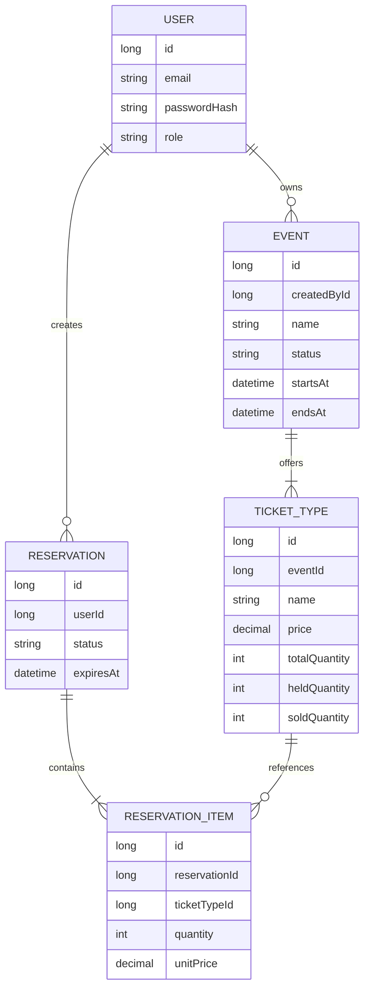

# RushSeat — Mô hình miền nghiệp vụ

## 1. Mục tiêu

Tài liệu này mô tả các thực thể nghiệp vụ cốt lõi của RushSeat, mối quan hệ giữa chúng, trách nhiệm của từng đối tượng và các quy tắc phải được duy trì trong suốt vòng đời hệ thống.

Mô hình miền được sử dụng làm cơ sở cho việc thiết kế các lớp Java thuần trong `business`, trước khi triển khai các adapter lưu trữ dữ liệu ở `data`.

Các lớp miền không nên phụ thuộc trực tiếp vào Spring Data JPA, Hibernate hoặc các framework persistence.

## 2. Tổng quan các thực thể

### 2.1. User

Đại diện cho một tài khoản sử dụng hệ thống.

**Thông tin chính:**

- `id`: Định danh người dùng.
- `email`: Địa chỉ email.
- `passwordHash`: Mật khẩu đã được băm.
- `role`: Vai trò người dùng.
- `createdAt`: Thời điểm tạo tài khoản.

**Vai trò trong nghiệp vụ:**

- `CUSTOMER`: Đặt vé và quản lý reservation của bản thân.
- `ORGANIZER`: Quản lý sự kiện thuộc quyền sở hữu của mình.
- `ADMIN`: Thực hiện các tác vụ quản trị được cho phép.

**Quy tắc:**

- Email phải hợp lệ theo quy tắc đầu vào của hệ thống và không được trùng.
- Mật khẩu thô không được lưu trong mô hình lưu trữ; hệ thống sử dụng giá trị đã băm.
- Quyền truy cập phải được kiểm tra ở các use case liên quan.
- Vai trò người dùng không tự động chứng minh quyền sở hữu một Event hoặc Reservation.

### 2.2. Event

Đại diện cho một sự kiện được tổ chức và có các loại vé để đặt.

**Thông tin chính:**

- `id`: Định danh sự kiện.
- `createdById`: Người sở hữu hoặc tạo sự kiện.
- `name`: Tên sự kiện.
- `description`: Mô tả.
- `status`: Trạng thái sự kiện.
- `startsAt`: Thời điểm bắt đầu sự kiện và cũng là mốc bắt đầu mở bán trong MVP.
- `endsAt`: Thời điểm kết thúc sự kiện.
- `createdAt`: Thời điểm tạo.

**Vòng đời:**

- `DRAFT`: Đang được chuẩn bị.
- `PUBLISHED`: Đã được công khai.
- `CANCELLED`: Đã bị hủy.

Trong MVP, `CANCELLED` là trạng thái kết thúc. Không cho phép sự kiện đã hủy quay lại `PUBLISHED`.

**Quy tắc:**

- Event phải có tên và thời gian hợp lệ.
- `endsAt` phải sau `startsAt`.
- Organizer chỉ được quản lý Event thuộc quyền sở hữu của mình.
- Admin có quyền quản lý Event trên toàn hệ thống.
- Chỉ Event ở trạng thái `PUBLISHED` mới có thể nhận reservation.
- Thời điểm hiện tại phải nằm trong khoảng `[startsAt, endsAt)`.
- Event đã bị hủy không được nhận reservation mới hoặc xác nhận reservation đang giữ chỗ.

### 2.3. TicketType

Đại diện cho một loại vé thuộc một Event.

**Thông tin chính:**

- `id`: Định danh loại vé.
- `eventId`: Event sở hữu loại vé.
- `name`: Tên loại vé.
- `price`: Giá vé.
- `totalQuantity`: Tổng số vé.
- `heldQuantity`: Số vé đang được giữ.
- `soldQuantity`: Số vé đã bán.

**Quy tắc tồn kho:**

`availableQuantity = totalQuantity - heldQuantity - soldQuantity`

Luôn phải bảo đảm:

- `totalQuantity >= 0`
- `heldQuantity >= 0`
- `soldQuantity >= 0`
- `heldQuantity + soldQuantity <= totalQuantity`
- `price >= 0`

Một TicketType thuộc duy nhất một Event. Trong MVP, tên loại vé không được trùng trong cùng một Event.

**Trách nhiệm nghiệp vụ:**

- Xác định số lượng vé còn khả dụng.
- Kiểm tra số lượng vé có thể được giữ.
- Bảo đảm các phép chuyển đổi tồn kho không vi phạm giới hạn.

Việc kiểm soát đồng thời khi nhiều yêu cầu cùng giữ vé cần được bảo đảm ở tầng xử lý nghiệp vụ kết hợp với cơ chế đồng bộ hóa phù hợp tại cơ sở dữ liệu.

### 2.4. Reservation

Đại diện cho một yêu cầu đặt và giữ vé của Customer.

**Thông tin chính:**

- `id`: Định danh reservation.
- `userId`: Customer sở hữu reservation.
- `status`: Trạng thái reservation.
- `expiresAt`: Thời điểm hết hạn giữ chỗ.
- `createdAt`: Thời điểm tạo.
- `updatedAt`: Thời điểm cập nhật gần nhất.

**Các trạng thái:**

| Trạng thái | Ý nghĩa |
|---|---|
| `HELD` | Vé đã được giữ nhưng chưa xác nhận |
| `CONFIRMED` | Reservation đã được xác nhận |
| `CANCELLATION_PENDING` | Reservation đã xác nhận đang chờ hoàn tất quy trình hủy |
| `CANCELLED` | Reservation đã bị hủy |
| `EXPIRED` | Reservation hết thời hạn giữ chỗ |

**Các chuyển đổi chính:**

- `HELD → CONFIRMED`: Customer xác nhận hợp lệ trước khi hết hạn.
- `HELD → CANCELLED`: Reservation được hủy theo quy tắc cho phép.
- `HELD → EXPIRED`: Reservation hết thời hạn giữ chỗ.
- `CONFIRMED → CANCELLATION_PENDING`: Sự kiện bị hủy và reservation cần được xử lý.
- `CANCELLATION_PENDING → CANCELLED`: Quy trình hủy hoàn tất.

Các chuyển đổi khác chỉ được bổ sung khi có quy tắc nghiệp vụ cụ thể.

**Quy tắc:**

- Reservation phải thuộc một Customer.
- Reservation phải có ít nhất một ReservationItem.
- Tất cả ReservationItem trong cùng một Reservation phải thuộc cùng một Event.
- Reservation ở `HELD` phải có thời hạn giữ chỗ hợp lệ.
- Customer chỉ được tự hủy Reservation ở trạng thái `HELD`.
- Customer không được tự hủy Reservation ở trạng thái `CONFIRMED`.
- Reservation `CONFIRMED` có thể được đưa vào quy trình hủy khi Event bị hủy.
- Reservation đã ở trạng thái kết thúc không được xử lý lại như một Reservation còn hoạt động.
- Việc chuyển trạng thái phải nhất quán với thay đổi tồn kho.
- `CANCELLED` không tự thể hiện kết quả hoàn tiền.
### 2.5. ReservationItem

Đại diện cho một dòng vé trong Reservation.

**Thông tin chính:**

- `id`: Định danh dòng vé.
- `reservationId`: Reservation chứa dòng vé.
- `ticketTypeId`: Loại vé được đặt.
- `quantity`: Số vé của loại này.
- `unitPrice`: Giá một vé tại thời điểm tạo reservation.

**Quy tắc:**

- `quantity > 0`.
- `unitPrice >= 0`.
- Mỗi loại vé chỉ xuất hiện tối đa một lần trong cùng một Reservation.
- `unitPrice` là giá snapshot tại thời điểm giữ vé, không tự động thay đổi khi giá TicketType được chỉnh sửa.
- Tổng tiền của Reservation được tính từ số lượng và giá snapshot của các ReservationItem; không tin tưởng tổng tiền do client gửi lên.

## 3. Quan hệ giữa các thực thể

Sơ đồ thể hiện quan hệ nghiệp vụ và các thuộc tính chính, không phải bản mô tả đầy đủ mọi cột hoặc ràng buộc SQL.

Trong MVP:

- Một User có thể sở hữu nhiều Event.
- Một User có thể tạo nhiều Reservation.
- Một Event có nhiều TicketType.
- Một Reservation có một hoặc nhiều ReservationItem.
- Một ReservationItem tham chiếu một TicketType.
- Các TicketType trong cùng Reservation phải thuộc cùng Event.

## 4. Các bất biến cấp miền

Bất biến là những điều kiện phải luôn đúng sau mỗi thao tác nghiệp vụ hợp lệ.

### 4.1. Bất biến tồn kho

Với mỗi TicketType:

`0 <= heldQuantity + soldQuantity <= totalQuantity`

Không được giữ hoặc bán số vé vượt quá tổng số vé được cấu hình.

### 4.2. Bất biến Reservation

- Reservation có ít nhất một ReservationItem.
- Mỗi ReservationItem có số lượng dương.
- Các ReservationItem trong cùng Reservation thuộc cùng một Event.
- Reservation chỉ chuyển trạng thái theo các chuyển đổi được phép.
- Mỗi lần chuyển trạng thái làm thay đổi tồn kho phải được thực hiện đúng một lần.

### 4.3. Bất biến Event

- Event có khoảng thời gian hợp lệ.
- Event `DRAFT` chưa được mở cho khách đặt vé.
- Event `PUBLISHED` chỉ nhận reservation trong khoảng thời gian được phép.
- Event `CANCELLED` không nhận reservation mới hoặc xác nhận reservation đang giữ chỗ.

### 4.4. Bất biến về giá

- Giá vé được xác định bởi dữ liệu phía máy chủ.
- ReservationItem lưu giá tại thời điểm giữ vé.
- Thay đổi giá của TicketType không làm thay đổi giá snapshot của reservation đã tạo.

## 5. Quy tắc xuyên suốt nhiều thực thể

Một số quy tắc không thuộc riêng một thực thể mà liên quan đến nhiều thực thể cùng lúc.

### 5.1. Tạo Reservation

Khi tạo Reservation, hệ thống cần:

1. Kiểm tra Event có đang cho phép đặt vé.
2. Kiểm tra các TicketType thuộc cùng Event.
3. Kiểm tra số lượng hợp lệ và tồn kho.
4. Xác định giá vé từ dữ liệu phía máy chủ.
5. Tạo Reservation và ReservationItem.
6. Tăng `heldQuantity` tương ứng.

Các thay đổi phải được thực hiện sao cho không tạo ra reservation thành công nhưng tồn kho chưa được giữ, hoặc ngược lại.

### 5.2. Xác nhận Reservation

Khi xác nhận Reservation đang `HELD`, hệ thống phải kiểm tra thời hạn giữ chỗ và trạng thái Event.

Nếu hợp lệ, Reservation chuyển sang `CONFIRMED`; số lượng vé tương ứng được chuyển từ `heldQuantity` sang `soldQuantity`.

Nếu Event đã bị hủy hoặc reservation đã hết hạn, không được xác nhận thành công.

### 5.3. Hủy hoặc hết hạn Reservation

Khi Reservation `HELD` chuyển sang `CANCELLED` hoặc `EXPIRED`, hệ thống phải giảm `heldQuantity` tương ứng.

Reservation hết hạn khi thời điểm hiện tại lớn hơn hoặc bằng `expiresAt`.

RushSeat sử dụng hai cơ chế phối hợp để xử lý Reservation hết hạn:

- Tác vụ nền chạy định kỳ để tìm và giải phóng vé của các Reservation đã hết hạn.
- Use case xác nhận tự kiểm tra thời hạn để từ chối Reservation đã hết hạn, kể cả khi tác vụ nền chưa chạy.

Việc cập nhật trạng thái và tồn kho phải được thực hiện an toàn khi có yêu cầu đồng thời.

Customer không được tự hủy Reservation ở trạng thái `CONFIRMED`. Reservation đã xác nhận chỉ được đưa vào quy trình hủy khi có nghiệp vụ hợp lệ, chẳng hạn Event bị hủy.
### 5.4. Hủy Event

Khi Event bị hủy:

- Reservation `HELD` được chuyển sang `CANCELLED` và giải phóng lượng vé đang giữ.
- Reservation `CONFIRMED` chuyển sang `CANCELLATION_PENDING`.
- Sau khi các cập nhật dữ liệu nội bộ cần thiết thành công, Reservation chuyển sang `CANCELLED`.
- Khi quy trình hủy hoàn tất, hệ thống giảm `soldQuantity` theo số lượng vé liên quan nếu chính sách xác định các vé này không còn được tính là đã bán.
- Không cho phép tạo hoặc xác nhận Reservation mới cho Event đã hủy.
- Việc hủy Reservation không đồng nghĩa với việc tiền đã được hoàn.

Nếu quy trình xử lý hủy sử dụng nhiều transaction, hệ thống phải có cơ chế phát hiện và tiếp tục xử lý các Reservation chưa hoàn tất, đồng thời bảo đảm không cập nhật tồn kho nhiều lần.
## 6. Ranh giới giữa Domain và Data

Các đối tượng trong `business` mô tả khái niệm và quy tắc nghiệp vụ. Chúng không cần biết dữ liệu được lưu bằng PostgreSQL hay được truy xuất bằng Spring Data JPA.

Ví dụ về trách nhiệm:

- `Event`: biểu diễn thông tin và quy tắc hợp lệ của sự kiện.
- `TicketType`: biểu diễn thông tin loại vé và các quy tắc tồn kho.
- `Reservation`: biểu diễn trạng thái và các chuyển đổi hợp lệ.
- `ReservationItem`: biểu diễn số lượng vé và giá snapshot.
- Các repository port trong `business`: mô tả nhu cầu truy xuất hoặc cập nhật dữ liệu.
- Các adapter trong `data`: triển khai việc truy xuất và cập nhật PostgreSQL.

Không nên đưa các annotation như `@Entity`, `@Table` hoặc các interface của Spring Data JPA vào các domain model thuần.

## 7. Các điểm cần xác định khi phát triển tiếp

1. **Quyền chỉnh sửa Event:** Xác định các trường được chỉnh sửa ở trạng thái `DRAFT` và `PUBLISHED`, đặc biệt khi đã có Reservation.
2. **Thời điểm mở bán:** Nếu khác `startsAt`, bổ sung trường thời gian mở bán riêng.
3. **Thay đổi số lượng vé:** Xác định điều kiện giảm `totalQuantity` khi đã có vé đang giữ hoặc đã bán.
4. **Cơ chế xử lý hủy Event:** Chốt ranh giới transaction, cách xử lý nhiều Reservation và cơ chế tiếp tục xử lý khi một phần quy trình thất bại.
5. **Tác vụ nền hết hạn:** Xác định chu kỳ chạy, kích thước mỗi lô và chính sách retry khi triển khai.

Các quyết định nghiệp vụ đã thống nhất:

- `CANCELLATION_PENDING` là trạng thái trung gian.
- Trong MVP, quy trình hủy hoàn tất sau khi các cập nhật dữ liệu nội bộ cần thiết thành công.
- Customer không được tự hủy Reservation `CONFIRMED`.
- Reservation hết hạn được xử lý bằng tác vụ nền định kỳ kết hợp kiểm tra thời hạn khi xác nhận.
- MVP chưa tích hợp cổng thanh toán; trạng thái `CANCELLED` không xác nhận việc hoàn tiền.