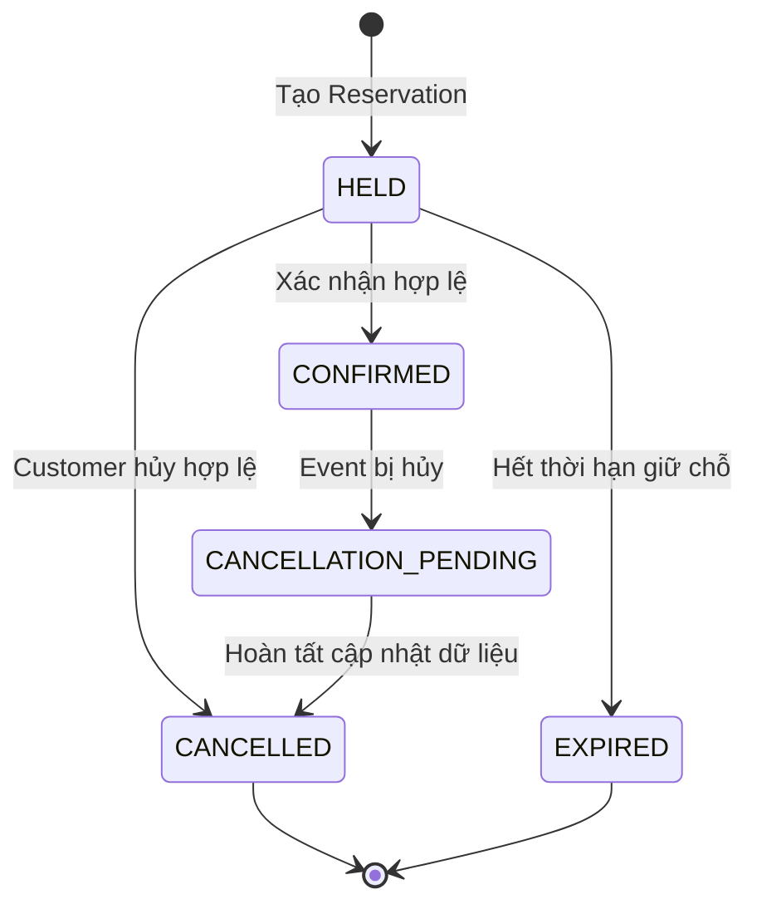

# Vòng đời Reservation

## 1. Mục tiêu

Tài liệu mô tả vòng đời của `Reservation`, các trạng thái hợp lệ và tác động của từng chuyển đổi lên tồn kho vé.

Reservation đại diện cho việc giữ hoặc xác nhận một số lượng vé của Customer. Hệ thống phải bảo đảm trạng thái Reservation nhất quán với số lượng vé đang giữ và đã bán.

## 2. Các trạng thái

| Trạng thái | Ý nghĩa | Tồn kho liên quan |
|---|---|---|
| `HELD` | Vé đang được giữ, chưa xác nhận | Tính vào `held_quantity` |
| `CONFIRMED` | Reservation đã được xác nhận | Tính vào `sold_quantity` |
| `CANCELLATION_PENDING` | Reservation đã xác nhận, đang chờ hoàn tất quy trình hủy | Chờ hoàn tất xử lý hủy |
| `CANCELLED` | Reservation đã bị hủy | Không còn tính vào tồn kho hoạt động sau khi xử lý hoàn tất |
| `EXPIRED` | Reservation đã hết thời hạn giữ chỗ | Không còn tính vào `held_quantity` |

## 3. Các chuyển đổi trạng thái

### 3.1. Tạo Reservation

`NEW → HELD`

Hệ thống tạo Reservation khi:

- Event đang cho phép đặt vé.
- Các TicketType hợp lệ và thuộc cùng Event.
- Số lượng yêu cầu lớn hơn 0.
- Tồn kho đáp ứng yêu cầu.

Khi tạo thành công, hệ thống tăng `held_quantity` theo số lượng vé được giữ.

Thời hạn giữ vé mặc định là 5 phút kể từ thời điểm tạo Reservation.

### 3.2. Xác nhận Reservation

`HELD → CONFIRMED`

Reservation chỉ được xác nhận khi:

- Reservation vẫn ở trạng thái `HELD`.
- Thời điểm xác nhận nhỏ hơn `expiresAt`.
- Event vẫn cho phép xác nhận.
- Customer có quyền xác nhận Reservation đó.

Khi xác nhận thành công:

- Giảm `held_quantity`.
- Tăng `sold_quantity`.
- Chuyển trạng thái Reservation sang `CONFIRMED`.

Các thay đổi phải nhất quán trong cơ sở dữ liệu.

### 3.3. Customer hủy Reservation đang giữ vé

`HELD → CANCELLED`

Customer được phép tự hủy Reservation ở trạng thái `HELD` nếu đáp ứng các điều kiện nghiệp vụ.

Khi hủy thành công, hệ thống giảm `held_quantity` theo số lượng vé trong ReservationItem.

Thao tác giải phóng tồn kho chỉ được thực hiện một lần.

### 3.4. Reservation hết hạn

`HELD → EXPIRED`

Reservation hết hạn khi thời điểm hiện tại lớn hơn hoặc bằng `expiresAt`.

Hệ thống sử dụng hai cơ chế phối hợp:

- Tác vụ nền định kỳ tìm và xử lý các Reservation đã hết hạn.
- Use case xác nhận tự kiểm tra thời hạn để từ chối Reservation đã hết hạn, kể cả khi tác vụ nền chưa chạy.

Khi hết hạn được xử lý thành công:

- Chuyển Reservation sang `EXPIRED`.
- Giảm `held_quantity` tương ứng.

### 3.5. Hủy Reservation đã xác nhận do Event bị hủy

`CONFIRMED → CANCELLATION_PENDING → CANCELLED`

Customer không được tự hủy Reservation ở trạng thái `CONFIRMED`.

Khi Event bị hủy, các Reservation đã xác nhận được đưa vào quy trình xử lý hủy:

1. Chuyển Reservation sang `CANCELLATION_PENDING`.
2. Thực hiện các cập nhật dữ liệu nội bộ cần thiết.
3. Điều chỉnh `sold_quantity` theo chính sách hủy.
4. Chuyển Reservation sang `CANCELLED` khi xử lý hoàn tất.

Trong MVP, việc xử lý hủy hoàn tất khi các cập nhật dữ liệu nội bộ cần thiết đã thành công. Điều này không đồng nghĩa với việc tiền đã được hoàn.

Nếu cần duy trì `CANCELLATION_PENDING` qua nhiều transaction để hỗ trợ retry, hệ thống phải có cơ chế tiếp tục xử lý các Reservation chưa hoàn tất.
## 4. Quy tắc chuyển trạng thái

| Trạng thái hiện tại | Sự kiện kích hoạt | Trạng thái tiếp theo |
|---|---|---|
| `HELD` | Customer xác nhận hợp lệ | `CONFIRMED` |
| `HELD` | Customer hủy hợp lệ | `CANCELLED` |
| `HELD` | Đến hạn giữ vé mà chưa xác nhận | `EXPIRED` |
| `CONFIRMED` | Event bị hủy | `CANCELLATION_PENDING` |
| `CANCELLATION_PENDING` | Hoàn tất cập nhật dữ liệu nội bộ | `CANCELLED` |

Customer không được tự hủy Reservation ở trạng thái `CONFIRMED`.

### Xử lý `CANCELLATION_PENDING`

Khi Event bị hủy, các Reservation ở trạng thái `CONFIRMED` được đưa vào quy trình xử lý hủy.

Trong MVP, quy trình này hoàn tất khi các cập nhật dữ liệu nội bộ cần thiết đã thành công, bao gồm:

1. Xác định các ReservationItem liên quan.
2. Cập nhật số lượng vé đã bán theo chính sách hủy.
3. Chuyển Reservation sang `CANCELLED`.
4. Bảo đảm trạng thái Reservation và tồn kho nhất quán.

Việc hoàn tất quy trình này không đồng nghĩa với hoàn tiền.

**Lưu ý về triển khai:** Nếu toàn bộ thao tác được thực hiện trong cùng một transaction, `CANCELLATION_PENDING` có thể chỉ là trạng thái trung gian trong quá trình xử lý và không được quan sát như một trạng thái đã commit. Nếu cần lưu trạng thái này để theo dõi và tiếp tục xử lý sau lỗi, phải tách quy trình thành các giao dịch riêng và thiết kế cơ chế retry an toàn.

## 5. Sơ đồ trạng thái

## 6. Các bất biến

- Reservation chỉ được chuyển sang trạng thái hợp lệ theo quy tắc nghiệp vụ.
- `HELD` phải tương ứng với lượng vé đang giữ.
- `CONFIRMED` phải tương ứng với lượng vé đã bán.
- Mỗi lần giải phóng hoặc chuyển đổi tồn kho chỉ được thực hiện một lần.
- Reservation ở trạng thái kết thúc không được xử lý như reservation còn hoạt động.
- Event đã `CANCELLED` không thể nhận reservation mới hoặc xác nhận reservation đang giữ chỗ.

## 7. Thiết kế kỹ thuật

Trạng thái phải được kiểm tra và cập nhật theo cách an toàn khi có yêu cầu đồng thời. Không nên đọc trạng thái, quyết định trong Java rồi cập nhật vô điều kiện mà không có cơ chế đồng bộ hóa.

Cần xác định rõ ranh giới transaction giữa việc cập nhật reservation và tồn kho.

## 8. Ánh xạ package

- `api`: Nhận yêu cầu tạo, xác nhận và hủy reservation.
- `business`: Định nghĩa các chuyển đổi trạng thái và điều kiện hợp lệ.
- `data`: Đọc, cập nhật reservation và tồn kho.
- `infrastructure`: Hỗ trợ transaction hoặc tác vụ nền khi cần xử lý reservation hết hạn.

