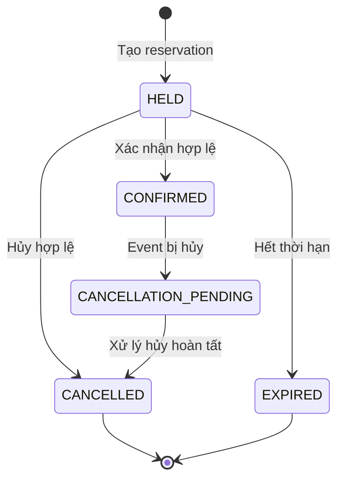

# Vòng đời Reservation

## 1. Mục tiêu

Tài liệu mô tả vòng đời của `Reservation`, các trạng thái hợp lệ và tác động của từng chuyển đổi lên tồn kho vé.

Reservation không chỉ là một bản ghi lưu thông tin đặt vé. Nó còn đại diện cho quyền giữ một số lượng vé trong một khoảng thời gian nhất định.

## 2. Các trạng thái

| Trạng thái | Ý nghĩa | Tồn kho liên quan |
|---|---|---|
| `HELD` | Vé đang được giữ, chưa xác nhận | Tính vào `held_quantity` |
| `CONFIRMED` | Reservation đã được xác nhận | Tính vào `sold_quantity` |
| `CANCELLATION_PENDING` | Đang xử lý hủy reservation đã xác nhận | Chờ hoàn tất xử lý hủy |
| `CANCELLED` | Reservation đã bị hủy | Không còn tính vào tồn kho hoạt động sau khi xử lý hoàn tất |
| `EXPIRED` | Reservation hết thời hạn giữ chỗ | Không còn tính vào `held_quantity` |

## 3. Các chuyển đổi trạng thái

### 3.1. Tạo reservation

`NEW → HELD`

Hệ thống tạo reservation khi Event cho phép đặt vé, số lượng yêu cầu hợp lệ và tồn kho đáp ứng yêu cầu.

Tại thời điểm tạo thành công, hệ thống phải tăng `held_quantity` tương ứng.

### 3.2. Xác nhận reservation

`HELD → CONFIRMED`

Chỉ được xác nhận khi reservation còn hiệu lực và Event vẫn cho phép xác nhận.

Tác động tồn kho:

- Giảm `held_quantity`.
- Tăng `sold_quantity`.

Hai thay đổi phải nhất quán trong cùng một giao dịch.

### 3.3. Hủy reservation đang giữ vé

`HELD → CANCELLED`

Khi reservation được hủy hợp lệ, hệ thống giảm `held_quantity` theo số lượng vé đã giữ.

Việc giải phóng phải xảy ra đúng một lần.

### 3.4. Hết hạn giữ vé

`HELD → EXPIRED`

Khi thời hạn giữ chỗ kết thúc mà reservation chưa được xác nhận, hệ thống chuyển trạng thái sang `EXPIRED` và giải phóng số vé đang giữ.

Không được vừa xác nhận vừa hết hạn thành công cho cùng một reservation.

### 3.5. Hủy reservation đã xác nhận do Event bị hủy

`CONFIRMED → CANCELLATION_PENDING → CANCELLED`

Khi Event bị hủy, reservation đã xác nhận chuyển sang `CANCELLATION_PENDING`.

Sau khi quy trình xử lý hủy hoàn tất, reservation chuyển sang `CANCELLED`. Nếu chính sách xác định số vé không còn được tính là đã bán, hệ thống giảm `sold_quantity` tương ứng.

Trạng thái reservation không xác nhận rằng tiền đã được hoàn.

## 4. Sơ đồ trạng thái

## 5. Các bất biến

- Reservation chỉ được chuyển sang trạng thái hợp lệ theo quy tắc nghiệp vụ.
- `HELD` phải tương ứng với lượng vé đang giữ.
- `CONFIRMED` phải tương ứng với lượng vé đã bán.
- Mỗi lần giải phóng hoặc chuyển đổi tồn kho chỉ được thực hiện một lần.
- Reservation ở trạng thái kết thúc không được xử lý như reservation còn hoạt động.
- Event đã `CANCELLED` không thể nhận reservation mới hoặc xác nhận reservation đang giữ chỗ.

## 6. Thiết kế kỹ thuật

Trạng thái phải được kiểm tra và cập nhật theo cách an toàn khi có yêu cầu đồng thời. Không nên đọc trạng thái, quyết định trong Java rồi cập nhật vô điều kiện mà không có cơ chế đồng bộ hóa.

Cần xác định rõ ranh giới transaction giữa việc cập nhật reservation và tồn kho.

## 7. Ánh xạ package

- `api`: Nhận yêu cầu tạo, xác nhận và hủy reservation.
- `business`: Định nghĩa các chuyển đổi trạng thái và điều kiện hợp lệ.
- `data`: Đọc, cập nhật reservation và tồn kho.
- `infrastructure`: Hỗ trợ transaction hoặc tác vụ nền khi cần xử lý reservation hết hạn.

