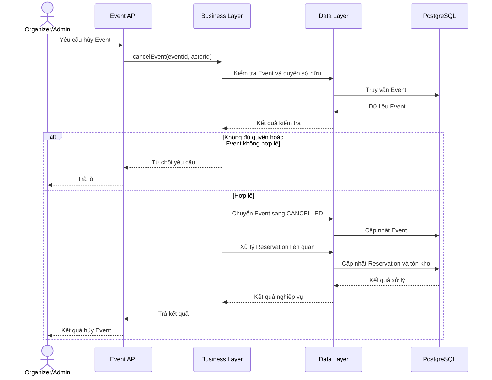

# Nghiệp vụ hủy Event và xử lý Reservation liên quan

## 1. Mục tiêu

Cho phép Organizer hủy Event do mình sở hữu và cho phép Admin hủy Event theo quyền quản trị toàn hệ thống.

Khi Event bị hủy, hệ thống phải ngừng tiếp nhận Reservation mới, ngăn việc xác nhận Reservation đang giữ vé và xử lý các Reservation đã tồn tại theo trạng thái tương ứng.

## 2. Tác nhân

- **Organizer:** Hủy Event do mình sở hữu.
- **Admin:** Hủy Event theo quyền quản trị.
- **Customer:** Người sở hữu các Reservation liên quan.
- **Hệ thống:** Cập nhật Event, xử lý Reservation và điều chỉnh tồn kho.

## 3. Quy tắc nghiệp vụ

### 3.1. Quyền hủy Event

1. Organizer chỉ được hủy Event thuộc quyền sở hữu của mình.
2. Admin có quyền quản lý Event trên toàn hệ thống.
3. Customer không được hủy Event.
4. Hệ thống phải kiểm tra cả vai trò và quyền sở hữu tài nguyên.

### 3.2. Trạng thái Event

Trong MVP, `EventStatus` gồm:

- `DRAFT`
- `PUBLISHED`
- `CANCELLED`

`CANCELLED` là trạng thái kết thúc. Event đã hủy không được công khai hoặc mở bán trở lại trong MVP.

Khi Event đã `CANCELLED`:

- Không được tạo Reservation mới.
- Không được xác nhận Reservation đang giữ vé.
- Các Reservation hiện có phải được xử lý theo quy tắc dưới đây.

### 3.3. Xử lý Reservation

| Trạng thái trước khi Event bị hủy | Trạng thái tiếp theo | Xử lý tồn kho |
|---|---|---|
| `HELD` | `CANCELLED` | Giảm `held_quantity` |
| `CONFIRMED` | `CANCELLATION_PENDING` | Chưa giảm `sold_quantity` cho đến khi xử lý hủy hoàn tất |
| `CANCELLATION_PENDING` | `CANCELLED` | Giảm `sold_quantity` theo chính sách hủy khi hoàn tất |
| `CANCELLED` | Không đổi | Không xử lý lại |

Customer không được tự hủy Reservation đã `CONFIRMED`. Việc đưa Reservation đó vào quy trình hủy được kích hoạt bởi nghiệp vụ hủy Event.

## 4. Luồng nghiệp vụ

### Bước 1 — Tiếp nhận yêu cầu

Organizer hoặc Admin gửi yêu cầu hủy Event.

Hệ thống xác thực người thực hiện và kiểm tra quyền quản lý Event.

Nếu Organizer không sở hữu Event, hệ thống từ chối yêu cầu.

### Bước 2 — Chuyển Event sang `CANCELLED`

Hệ thống chuyển Event sang `CANCELLED`.

Từ thời điểm này, các use case tạo và xác nhận Reservation phải từ chối những thao tác không còn hợp lệ.

Việc cập nhật trạng thái Event cần được phối hợp với các use case Reservation để xử lý yêu cầu đồng thời.

### Bước 3 — Xử lý Reservation `HELD`

Với mỗi Reservation đang `HELD`:

1. Chuyển Reservation sang `CANCELLED`.
2. Giảm `held_quantity` theo số lượng vé đang giữ.
3. Bảo đảm thao tác giải phóng chỉ được thực hiện một lần.

### Bước 4 — Xử lý Reservation `CONFIRMED`

Với mỗi Reservation đang `CONFIRMED`:

1. Đưa Reservation vào `CANCELLATION_PENDING`.
2. Thực hiện các cập nhật dữ liệu nội bộ cần thiết.
3. Giảm `sold_quantity` theo số lượng vé liên quan nếu chính sách hủy xác định các vé không còn được tính là đã bán.
4. Chuyển Reservation sang `CANCELLED` khi xử lý hoàn tất.

Trong MVP, hoàn tất xử lý hủy nghĩa là các cập nhật dữ liệu nội bộ cần thiết đã thành công. Không có cổng thanh toán nên hệ thống không được thông báo rằng tiền đã được hoàn.

### Bước 5 — Trả kết quả

Hệ thống trả kết quả cho Organizer hoặc Admin.

Kết quả cần phản ánh trạng thái Event và kết quả xử lý Reservation theo thiết kế đã chọn.

Nếu quy trình được chia thành nhiều transaction và vẫn còn Reservation chưa xử lý, hệ thống phải có cách ghi nhận và tiếp tục phần việc còn lại.

## 5. Thiết kế kỹ thuật

### 5.1. Ranh giới transaction

Có hai hướng triển khai.

**Một transaction cho toàn bộ quy trình**

Ưu điểm:
- Tính nguyên tử đơn giản hơn.
- Nếu một thao tác bắt buộc thất bại, các thay đổi trong transaction có thể rollback.

Nhược điểm:
- Có thể giữ khóa lâu khi Event có nhiều Reservation.
- Khối lượng công việc lớn có thể làm tăng tranh chấp tài nguyên.

**Nhiều transaction nhỏ**

Ưu điểm:
- Có thể xử lý số lượng Reservation lớn hơn theo từng lô.
- Giảm thời gian mỗi transaction giữ khóa.

Nhược điểm:
- Event có thể đã `CANCELLED` trong khi một số Reservation vẫn chưa xử lý xong.
- Cần cơ chế theo dõi, tiếp tục xử lý và retry an toàn.
- Phải bảo đảm việc chạy lại không làm thay đổi tồn kho nhiều lần.

Với MVP, có thể bắt đầu bằng một quy trình đơn giản với transaction phù hợp. Nếu tách thành nhiều transaction, cần thiết kế cơ chế tiếp tục xử lý trước khi triển khai.

### 5.2. Kiểm soát đồng thời

Cần xử lý ít nhất hai tình huống:

**Hủy Event đồng thời với xác nhận Reservation**

Không được để Reservation được xác nhận theo một trạng thái Event không còn hợp lệ. Việc kiểm tra Event và cập nhật Reservation phải được phối hợp bằng cơ chế đồng bộ hóa phù hợp.

**Nhiều yêu cầu cùng xử lý một Reservation**

Chỉ một yêu cầu được phép thực hiện chuyển trạng thái và điều chỉnh tồn kho. Các yêu cầu còn lại phải phát hiện trạng thái đã thay đổi và không thực hiện lại phép cập nhật.

### 5.3. Tính nhất quán

Các bất biến tồn kho phải luôn được bảo đảm:

- `held_quantity >= 0`
- `sold_quantity >= 0`
- `held_quantity + sold_quantity <= total_quantity`

Vé được giải phóng do Event bị hủy không được phép quay trở lại trạng thái có thể bán trong Event đó.

## 6. Sequence diagram

Sơ đồ mô tả luồng tổng quát. Nếu xử lý theo nhiều transaction nhỏ, cần bổ sung sơ đồ riêng cho cơ chế tiếp tục xử lý và retry.

## 7. Các trường hợp lỗi cần kiểm thử
1. Organizer hủy Event do mình sở hữu.
2. Organizer cố hủy Event của Organizer khác.
3. Admin hủy Event.
4. Customer cố hủy Event.
5. Event đã CANCELLED nhận yêu cầu hủy lần nữa.
6. Event bị hủy đồng thời với việc xác nhận Reservation.
7. Reservation HELD được giải phóng tồn kho đúng một lần.
8. Reservation CONFIRMED chuyển sang CANCELLATION_PENDING.
9. Reservation CANCELLATION_PENDING chuyển sang CANCELLED sau khi cập nhật dữ liệu nội bộ thành công.
10. Hai yêu cầu cùng xử lý một Reservation.
11. Transaction thất bại trong quá trình cập nhật tồn kho.
12. Quy trình không thông báo hoàn tiền thành công khi chưa có xác nhận từ hệ thống thanh toán.
## 8. Ánh xạ package
- api: Endpoint hủy Event.
- business: Kiểm tra quyền, điều phối quy trình hủy và xác định điều kiện chuyển trạng thái.
- data: Cập nhật Event, Reservation và tồn kho.
- infrastructure: Hỗ trợ transaction, tác vụ nền hoặc retry nếu quy trình được tách thành nhiều bước.
