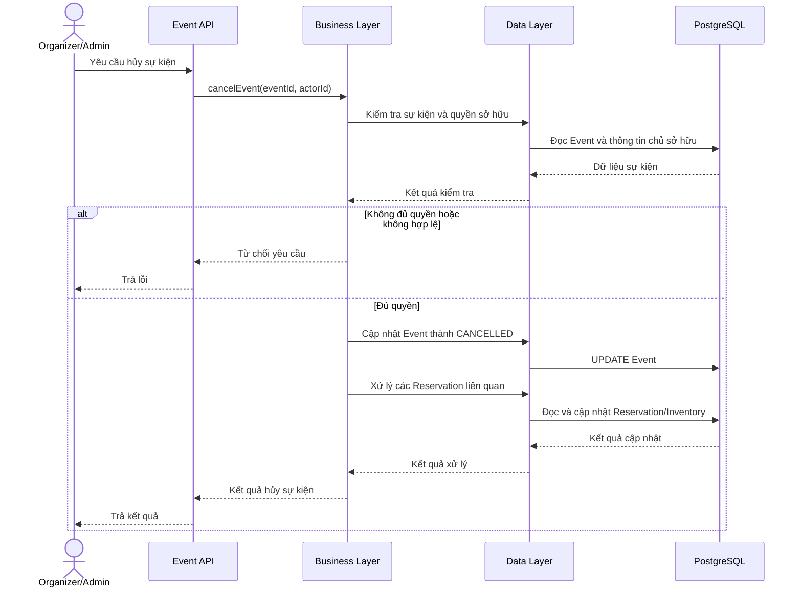
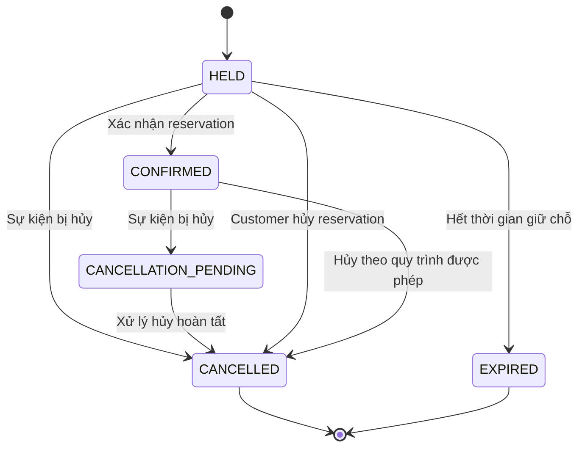

# Hủy sự kiện và xử lý Reservation liên quan

## 1. Mục tiêu nghiệp vụ

Cho phép Organizer hủy sự kiện do mình quản lý và cho phép Admin hủy sự kiện theo quyền quản trị toàn hệ thống.

Khi một sự kiện bị hủy, hệ thống phải ngừng tiếp nhận reservation mới, ngăn các reservation đang giữ chỗ được xác nhận và xử lý những reservation đã tồn tại theo trạng thái tương ứng.

Quy trình cần bảo đảm tính nhất quán của trạng thái reservation và số lượng vé, kể cả khi nhiều yêu cầu được xử lý đồng thời.

### 1.1. Các tác nhân

- **Organizer:** Hủy sự kiện do mình sở hữu.
- **Admin:** Hủy sự kiện theo quyền quản trị toàn hệ thống.
- **Customer:** Người dùng có reservation thuộc sự kiện bị hủy.
- **Hệ thống:** Kiểm tra quyền, cập nhật trạng thái sự kiện, xử lý reservation liên quan và điều chỉnh số lượng vé.

### 1.2. Phạm vi MVP

MVP chưa tích hợp cổng thanh toán. Vì vậy, tài liệu này mô tả quy trình hủy reservation và cập nhật dữ liệu nội bộ; không giả định rằng hệ thống đã thực hiện hoặc xác nhận hoàn tiền.

Việc hoàn tiền sẽ là một nghiệp vụ riêng khi RushSeat tích hợp thanh toán.

## 2. Quy tắc nghiệp vụ

### 2.1. Quyền hủy sự kiện

1. Organizer chỉ được hủy sự kiện do mình sở hữu.
2. Admin có quyền quản lý sự kiện trên toàn hệ thống.
3. Customer không có quyền hủy sự kiện.
4. Hệ thống phải kiểm tra cả quyền theo vai trò và quyền sở hữu tài nguyên. Chỉ kiểm tra role là chưa đủ để bảo đảm Organizer không can thiệp vào sự kiện của người khác.

### 2.2. Trạng thái sự kiện

Trong MVP, `EventStatus` gồm:

- `DRAFT`: Sự kiện đang được chuẩn bị, chưa công khai.
- `PUBLISHED`: Sự kiện đã được công khai.
- `CANCELLED`: Sự kiện đã bị hủy.

`CANCELLED` là trạng thái kết thúc trong MVP. Sự kiện đã hủy không được mở bán hoặc nhận reservation trở lại.

Hệ thống cần từ chối yêu cầu tạo reservation mới và yêu cầu xác nhận reservation đang giữ chỗ nếu sự kiện đã bị hủy.

### 2.3. Xử lý reservation theo trạng thái

| Trạng thái trước khi sự kiện bị hủy | Trạng thái tiếp theo | Xử lý số lượng vé |
|---|---|---|
| `HELD` | `CANCELLED` | Giảm `held_quantity` theo số lượng đã giữ |
| `CONFIRMED` | `CANCELLATION_PENDING` | Chưa hoàn tất xử lý hủy; chưa tự động giải phóng số lượng đã bán |
| `CANCELLATION_PENDING` | `CANCELLED` | Hoàn tất xử lý hủy và cập nhật số lượng đã bán theo quy tắc đã xác định |
| `CANCELLED` | Không đổi | Không xử lý lặp lại |

`CANCELLATION_PENDING` là trạng thái trung gian, không phải trạng thái kết thúc. Reservation chỉ chuyển sang `CANCELLED` khi quy trình xử lý hủy hoàn tất.

### 2.4. Quy tắc cập nhật tồn kho

RushSeat quản lý số lượng vé bằng ba trường:

- `total_quantity`: Tổng số vé được tạo.
- `held_quantity`: Số vé đang được giữ bởi reservation chưa xác nhận.
- `sold_quantity`: Số vé đã được xác nhận.

Số lượng vé còn khả dụng được tính bằng:

`available_quantity = total_quantity - held_quantity - sold_quantity`

Các quy tắc cần bảo đảm:

1. Khi hủy reservation ở trạng thái `HELD`, hệ thống phải giảm `held_quantity` đúng một lần.
2. Khi reservation đã `CONFIRMED` chuyển sang `CANCELLATION_PENDING`, chưa được coi là đã hủy hoàn tất.
3. Khi xử lý hủy reservation đã xác nhận hoàn tất, hệ thống cần giảm `sold_quantity` theo số lượng vé của reservation đó, nếu chính sách nghiệp vụ xác định các vé này không còn được tính là đã bán.
4. Không được giải phóng tồn kho nhiều lần nếu nhiều yêu cầu cùng xử lý một reservation.
5. Việc cập nhật trạng thái và tồn kho liên quan phải nhất quán trong cơ sở dữ liệu.

Do sự kiện đã bị hủy nên vé được giải phóng không được phép quay trở lại trạng thái có thể bán trong sự kiện đó.

### 2.5. Quy tắc về hoàn tiền

Trạng thái reservation không đại diện cho trạng thái hoàn tiền.

Ví dụ, `CANCELLED` chỉ cho biết reservation đã được hủy. Nó không chứng minh giao dịch hoàn tiền đã thành công.

Trong MVP:

- Chưa có tích hợp cổng thanh toán.
- Không tự động giả định rằng tiền đã được hoàn.
- Quy trình hủy reservation và quy trình hoàn tiền được xem là hai nghiệp vụ khác nhau.
- Khi tích hợp thanh toán, hệ thống cần có trạng thái hoặc bản ghi riêng để theo dõi quá trình hoàn tiền.

## 3. Luồng nghiệp vụ

### 3.1. Bước 1 — Tiếp nhận yêu cầu hủy

Organizer hoặc Admin gửi yêu cầu hủy sự kiện.

Hệ thống xác thực người dùng, kiểm tra quyền và xác minh sự kiện có thể được hủy theo chính sách hiện tại.

Nếu Organizer không sở hữu sự kiện, hệ thống từ chối yêu cầu.

### 3.2. Bước 2 — Chuyển sự kiện sang `CANCELLED`

Hệ thống cập nhật trạng thái sự kiện thành `CANCELLED`.

Từ thời điểm này, các yêu cầu tạo reservation mới phải bị từ chối. Các yêu cầu xác nhận reservation đang giữ chỗ cũng phải kiểm tra trạng thái sự kiện trước khi xác nhận.

Việc kiểm tra này cần được thực hiện trong luồng xử lý nghiệp vụ, không chỉ ở giao diện hoặc API.

### 3.3. Bước 3 — Xử lý các reservation đang tồn tại

Hệ thống tìm và xử lý các reservation thuộc sự kiện bị hủy:

- Với `HELD`: chuyển sang `CANCELLED` và giải phóng số vé đang giữ.
- Với `CONFIRMED`: chuyển sang `CANCELLATION_PENDING`.
- Với `CANCELLATION_PENDING`: tiếp tục xử lý theo quy trình hủy.
- Với `CANCELLED`: không thực hiện lại thao tác.

Các reservation không thuộc sự kiện bị hủy không bị ảnh hưởng.

### 3.4. Bước 4 — Hoàn tất xử lý hủy reservation

Với reservation đang ở `CANCELLATION_PENDING`, hệ thống thực hiện các bước cần thiết để hoàn tất việc hủy.

Khi xử lý hoàn tất, reservation chuyển sang `CANCELLED`. Nếu chính sách tồn kho xác định vé không còn được tính là đã bán, hệ thống giảm `sold_quantity` tương ứng.

Trong MVP, cần xác định rõ điều kiện nào được xem là hoàn tất. Vì chưa có cổng thanh toán, việc hoàn tất hủy reservation không đồng nghĩa với việc hoàn tiền đã diễn ra.

### 3.5. Bước 5 — Trả kết quả

Hệ thống trả kết quả cho tác nhân yêu cầu hủy sự kiện.

Kết quả cần phản ánh việc sự kiện đã bị hủy và quy trình xử lý reservation liên quan đã được thực hiện đến đâu. Không được thông báo rằng tiền đã được hoàn nếu chưa có bằng chứng về giao dịch hoàn tiền thành công.

## 4. Thiết kế kỹ thuật

### 4.1. Ranh giới giao dịch

Việc chuyển trạng thái sự kiện và xử lý reservation có thể liên quan đến nhiều bản ghi trong cơ sở dữ liệu. Nếu toàn bộ thao tác được thực hiện trong một giao dịch lớn, hệ thống có thể giữ khóa lâu khi sự kiện có nhiều reservation.

Có hai hướng thiết kế:

**Phương án A — Một giao dịch cho toàn bộ quy trình**

Cập nhật sự kiện, chuyển trạng thái reservation và cập nhật tồn kho trong cùng một giao dịch.

Ưu điểm:
- Dễ bảo đảm tính nguyên tử.
- Nếu một thao tác thất bại, toàn bộ giao dịch có thể rollback.

Nhược điểm:
- Thời gian giao dịch có thể dài.
- Có thể gây tranh chấp khóa khi sự kiện có nhiều reservation.

**Phương án B — Tách thành các bước xử lý**

Đánh dấu sự kiện đã hủy trước, sau đó xử lý các reservation theo từng giao dịch nhỏ.

Ưu điểm:
- Dễ xử lý số lượng reservation lớn.
- Giảm thời gian mỗi giao dịch giữ khóa.

Nhược điểm:
- Có giai đoạn sự kiện đã hủy nhưng vẫn còn reservation chưa xử lý.
- Cần cơ chế tiếp tục xử lý, retry và phát hiện lỗi.
- Quy trình phải có khả năng chạy lại mà không cập nhật tồn kho nhiều lần.

Với RushSeat, có thể bắt đầu bằng phương án A khi dữ liệu nhỏ và quy trình đơn giản. Nếu chuyển sang phương án B, cần thiết kế khả năng xử lý tiếp và tính lặp an toàn trước khi triển khai.

### 4.2. Kiểm soát đồng thời

Hai tình huống cần được xử lý:

**Tình huống 1 — Hủy sự kiện đồng thời với xác nhận reservation**

Một yêu cầu xác nhận reservation và một yêu cầu hủy sự kiện có thể đến gần như đồng thời.

Hệ thống phải có cơ chế đồng bộ hóa phù hợp ở tầng cơ sở dữ liệu để tránh trường hợp reservation được xác nhận sau khi sự kiện đã bị hủy.

Chỉ kiểm tra trạng thái sự kiện trong Java trước khi cập nhật là chưa đủ, vì trạng thái có thể thay đổi sau lần kiểm tra đó.

**Tình huống 2 — Nhiều yêu cầu cùng hủy một reservation**

Nếu hai yêu cầu cùng xử lý một reservation, hệ thống chỉ được giải phóng số lượng vé một lần.

Có thể sử dụng cập nhật trạng thái có điều kiện, khóa bản ghi hoặc cơ chế kiểm soát đồng thời phù hợp. Lựa chọn cụ thể cần được kiểm thử bằng các tình huống chạy đồng thời.

### 4.3. Tính nhất quán dữ liệu

Các bất biến cần duy trì:

- `held_quantity >= 0`
- `sold_quantity >= 0`
- `held_quantity + sold_quantity <= total_quantity`
- Reservation chỉ chuyển sang trạng thái tiếp theo nếu trạng thái hiện tại phù hợp.
- Mỗi lần chuyển trạng thái phải đi kèm điều chỉnh tồn kho tương ứng đúng một lần.
- Reservation đã `CANCELLED` không được xử lý hủy lặp lại như một reservation còn hoạt động.

Các ràng buộc cơ sở dữ liệu hỗ trợ bảo vệ dữ liệu, nhưng không thay thế việc xác định đúng luồng nghiệp vụ và ranh giới giao dịch.

## 5. Sequence diagram

### 5.1. Hủy sự kiện và xử lý reservation

Sơ đồ trên mô tả luồng tổng quát. Nếu triển khai xử lý theo nhiều giao dịch nhỏ, cần bổ sung một sequence diagram riêng cho cơ chế tiếp tục xử lý và retry.

### 5.2. Chuyển trạng thái reservation

Sơ đồ cần được hiểu trong phạm vi các quy tắc nghiệp vụ đã định nghĩa. Luồng hủy reservation thông thường và luồng hủy do sự kiện bị hủy có thể có điều kiện khác nhau; khi triển khai, cần tránh cho phép mọi tác nhân tự do chuyển trạng thái.

## 6. Ánh xạ vào kiến trúc Hexagonal

### `api`

Chịu trách nhiệm tiếp nhận yêu cầu hủy sự kiện, kiểm tra dữ liệu đầu vào ở mức API và chuyển yêu cầu đến lớp nghiệp vụ.

Không nên đặt toàn bộ quy tắc quyền sở hữu, chuyển trạng thái reservation hoặc điều chỉnh tồn kho tại đây.

### `business`

Chứa quy tắc nghiệp vụ chính:

- Kiểm tra quyền hủy sự kiện và quyền sở hữu.
- Xác định các trạng thái hợp lệ.
- Điều phối quá trình xử lý reservation liên quan.
- Xác định khi nào việc hủy được xem là hoàn tất.
- Định nghĩa các port cần thiết để truy cập dữ liệu.

Lớp này không phụ thuộc trực tiếp vào Spring Data JPA hoặc Hibernate.

### `data`

Triển khai các adapter truy cập PostgreSQL:

- Đọc và cập nhật sự kiện.
- Truy vấn các reservation thuộc sự kiện.
- Cập nhật trạng thái reservation.
- Điều chỉnh số lượng vé.
- Triển khai cơ chế khóa hoặc cập nhật có điều kiện theo thiết kế đã chọn.

### `infrastructure`

Chứa các thành phần kỹ thuật hỗ trợ như cấu hình transaction, xử lý tác vụ nền hoặc cơ chế retry nếu quy trình được tách thành nhiều giao dịch.

Không cần đưa Kafka hoặc Redis vào chỉ để triển khai chức năng hủy sự kiện trong MVP. Chỉ bổ sung khi có yêu cầu và lý do kỹ thuật rõ ràng.

## 7. Các trường hợp lỗi cần kiểm thử

1. Organizer hủy sự kiện do mình sở hữu.
2. Organizer cố hủy sự kiện của Organizer khác.
3. Admin hủy sự kiện.
4. Customer cố hủy sự kiện.
5. Sự kiện đã `CANCELLED` nhận yêu cầu hủy lần nữa.
6. Sự kiện bị hủy trong lúc một reservation đang được xác nhận.
7. Reservation `HELD` được giải phóng tồn kho đúng một lần.
8. Reservation `CONFIRMED` chuyển sang `CANCELLATION_PENDING`.
9. Reservation `CANCELLATION_PENDING` được chuyển sang `CANCELLED` sau khi xử lý hoàn tất.
10. Hai yêu cầu đồng thời cùng xử lý một reservation.
11. Một thao tác cập nhật tồn kho thất bại giữa chừng.
12. Hệ thống không thông báo hoàn tiền thành công khi chưa có xác nhận từ quy trình thanh toán.

## 8. Các quyết định cần giữ nhất quán

- `CANCELLATION_PENDING` là trạng thái trung gian.
- `CANCELLED` là trạng thái kết thúc của quy trình hủy reservation.
- Hủy sự kiện không đồng nghĩa với hoàn tiền thành công.
- Việc cập nhật trạng thái và tồn kho phải an toàn khi có yêu cầu đồng thời.
- Nếu quy trình hủy được chia thành nhiều giao dịch, hệ thống phải hỗ trợ xử lý tiếp và retry an toàn.
- Khi tích hợp thanh toán, vòng đời hoàn tiền cần được thiết kế riêng, không gộp toàn bộ vào trạng thái reservation.
