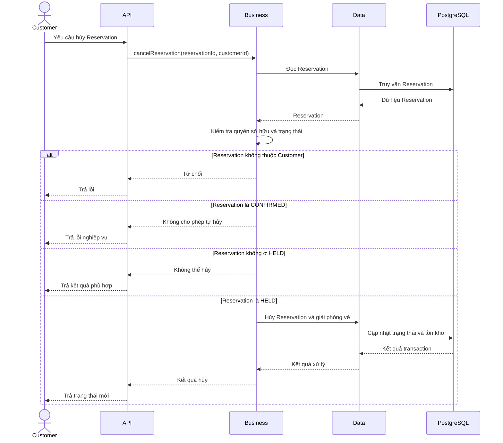

## 1. Mục tiêu

Cho phép Customer hủy Reservation đang giữ vé và bảo đảm số lượng vé được giải phóng đúng một lần.

Cần phân biệt việc Customer tự hủy Reservation với việc hệ thống hủy Reservation do Event bị hủy. Hai nghiệp vụ này có điều kiện và cách xử lý khác nhau.

## 2. Tác nhân

- **Customer:** Được tự hủy Reservation ở trạng thái `HELD` nếu đáp ứng điều kiện nghiệp vụ.
- **Organizer/Admin:** Có thể kích hoạt quy trình hủy Event theo quyền hạn tương ứng.
- **Hệ thống:** Cập nhật Reservation và tồn kho theo quy tắc nghiệp vụ.

Customer không được tự hủy Reservation ở trạng thái `CONFIRMED`.

## 3. Quy tắc nghiệp vụ

1. Reservation phải tồn tại.
2. Customer chỉ được thao tác trên Reservation thuộc quyền sở hữu của mình.
3. Customer chỉ được tự hủy Reservation đang ở trạng thái `HELD`.
4. Khi `HELD → CANCELLED`, hệ thống phải giảm `held_quantity` tương ứng.
5. Customer không được tự hủy Reservation ở trạng thái `CONFIRMED`.
6. Reservation `CONFIRMED` có thể được đưa vào quy trình hủy khi Event bị hủy.
7. Yêu cầu hủy lặp lại không được làm giảm tồn kho nhiều lần.
8. Reservation đã `CANCELLED` hoặc `EXPIRED` không được xử lý như Reservation đang hoạt động.
9. Việc hủy Reservation không đồng nghĩa với hoàn tiền.

## 4. Luồng nghiệp vụ

1. Customer gửi yêu cầu hủy Reservation.
2. Hệ thống xác định Customer từ ngữ cảnh xác thực.
3. Hệ thống kiểm tra quyền sở hữu Reservation.
4. Hệ thống kiểm tra trạng thái hiện tại.
5. Nếu Reservation ở `HELD`, hệ thống thực hiện hủy và giải phóng vé.
6. Nếu Reservation ở `CONFIRMED`, hệ thống từ chối yêu cầu tự hủy.
7. Nếu Reservation đã ở trạng thái kết thúc, hệ thống không thực hiện lại thay đổi tồn kho.
8. Hệ thống trả kết quả cho Customer.

## 5. Thiết kế kỹ thuật

### 5.1. Tính lặp an toàn

Khi hai yêu cầu cùng hủy một Reservation, chỉ một yêu cầu được phép thực hiện chuyển trạng thái và giải phóng tồn kho.

Hệ thống cần sử dụng cơ chế cập nhật có điều kiện, khóa bản ghi hoặc cơ chế đồng bộ hóa phù hợp.

Nếu trạng thái đã thay đổi, yêu cầu còn lại không được thực hiện phép trừ tồn kho lần nữa.

### 5.2. Transaction

Đối với Reservation ở `HELD`, các thao tác sau phải nhất quán:

1. Kiểm tra Reservation đang ở `HELD`.
2. Chuyển Reservation sang `CANCELLED`.
3. Giảm `held_quantity`.
4. Commit transaction.

Nếu cập nhật tồn kho thất bại, thay đổi trạng thái Reservation thuộc cùng transaction phải được rollback.

### 5.3. Phân biệt với hủy Event

Khi Event bị hủy, hệ thống xử lý Reservation liên quan theo use case `cancel-event.md`.

Trong trường hợp đó:

- Reservation `HELD` chuyển sang `CANCELLED`.
- Reservation `CONFIRMED` chuyển sang `CANCELLATION_PENDING`.
- Khi các cập nhật dữ liệu nội bộ cần thiết hoàn tất, Reservation chuyển sang `CANCELLED`.

Đây là quy trình do nghiệp vụ hủy Event kích hoạt, không phải quyền tự hủy của Customer.

## 6. Sequence diagram

## 7. Các trường hợp lỗi cần kiểm thử
- Customer hủy Reservation HELD thuộc quyền sở hữu của mình. 
- Customer cố hủy Reservation của người khác.
- Customer cố hủy Reservation CONFIRMED.
- Customer gửi yêu cầu hủy hai lần.
- Reservation chuyển trạng thái đồng thời với tác vụ hết hạn.
- Cập nhật tồn kho thất bại trong transaction.
- Reservation đã CANCELLED được gửi yêu cầu hủy lại.

## 7. Ánh xạ package

- `api`: Endpoint hủy reservation.
- `business`: Kiểm tra quyền, trạng thái và chính sách hủy.
- `data`: Cập nhật reservation và tồn kho.
- `infrastructure`: Cơ chế transaction và các thành phần kỹ thuật hỗ trợ nếu cần.
