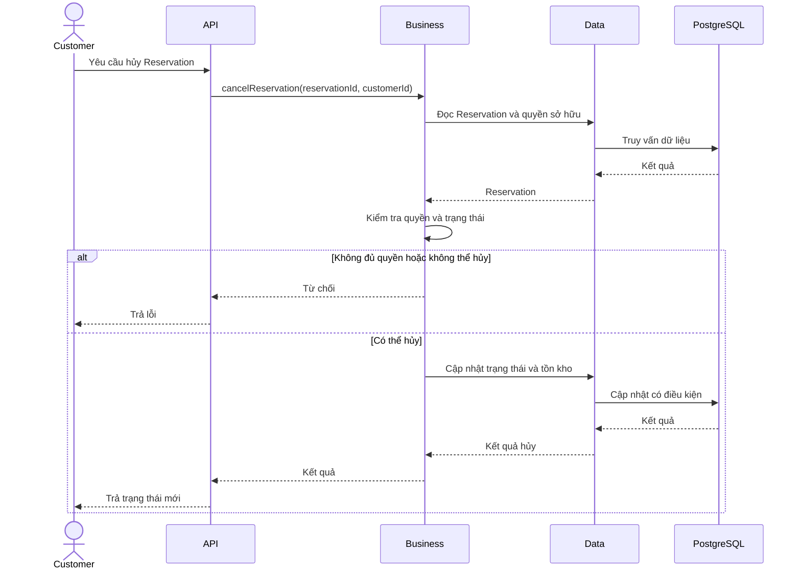

# Nghiệp vụ hủy Reservation

## 1. Mục tiêu

Cho phép xử lý việc hủy Reservation theo trạng thái hiện tại, bảo đảm số lượng vé được giải phóng đúng một lần.

Cần phân biệt hủy một Reservation với hủy toàn bộ Event. Hai nghiệp vụ này có phạm vi và tác động khác nhau.

## 2. Tác nhân

Customer sở hữu Reservation. Các tác nhân quản trị có thể thực hiện những thao tác bổ sung nếu được quy định trong chính sách quyền.

## 3. Quy tắc nghiệp vụ

1. Reservation phải tồn tại.
2. Customer chỉ được hủy reservation thuộc quyền sở hữu của mình.
3. Reservation `HELD` có thể chuyển sang `CANCELLED` nếu thỏa điều kiện hủy.
4. Khi `HELD → CANCELLED`, hệ thống giảm `held_quantity`.
5. Reservation đã `CONFIRMED` không được tự động áp dụng cùng quy tắc giải phóng tồn kho như reservation `HELD`.
6. Việc hủy reservation đã xác nhận phải tuân theo chính sách hủy riêng.
7. Yêu cầu hủy lặp lại không được làm giảm tồn kho nhiều lần.

**Điểm chưa chốt:** Điều kiện để Customer tự hủy reservation đã `CONFIRMED`. Không mặc định rằng Customer được hủy trong mọi trường hợp.

## 4. Luồng nghiệp vụ

1. Customer gửi yêu cầu hủy.
2. Hệ thống kiểm tra quyền sở hữu.
3. Kiểm tra trạng thái Reservation.
4. Nếu Reservation ở `HELD`, chuyển sang `CANCELLED` và giải phóng vé.
5. Nếu Reservation đã `CONFIRMED`, áp dụng chính sách hủy đã được phê duyệt.
6. Nếu trạng thái không cho phép hủy, từ chối yêu cầu.
7. Trả kết quả.

## 5. Thiết kế kỹ thuật

Việc hủy cần có tính lặp an toàn. Khi hai yêu cầu cùng hủy một Reservation, chỉ một yêu cầu được phép thực hiện chuyển trạng thái và điều chỉnh tồn kho.

Nếu trạng thái đã thay đổi, yêu cầu còn lại phải nhận kết quả phù hợp thay vì thực hiện lại phép trừ tồn kho.

## 6. Sequence diagram

## 7. Ánh xạ package

- `api`: Endpoint hủy reservation.
- `business`: Kiểm tra quyền, trạng thái và chính sách hủy.
- `data`: Cập nhật reservation và tồn kho.
- `infrastructure`: Cơ chế transaction hoặc xử lý tiếp nếu quy trình hủy được tách thành nhiều bước.
