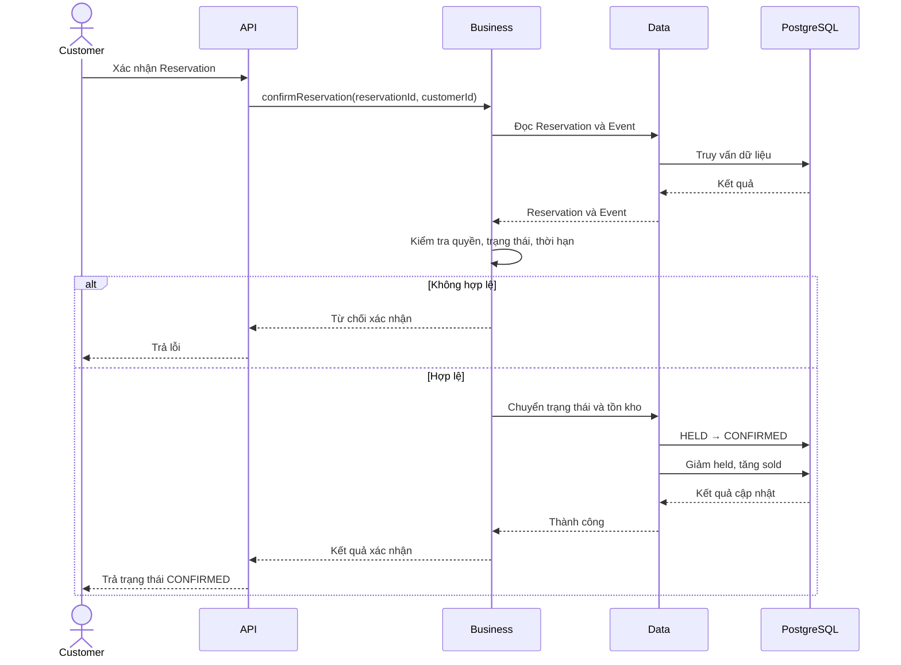

# Nghiệp vụ xác nhận Reservation

## 1. Mục tiêu

Chuyển một Reservation từ `HELD` sang `CONFIRMED` khi reservation còn hiệu lực và Event vẫn cho phép xác nhận.

Trong MVP, xác nhận reservation là thao tác nghiệp vụ nội bộ, chưa bao gồm xác thực thanh toán.

## 2. Tác nhân

Customer sở hữu Reservation.

## 3. Quy tắc nghiệp vụ

1. Reservation phải tồn tại.
2. Customer chỉ được xác nhận reservation thuộc quyền sở hữu của mình.
3. Reservation phải ở trạng thái `HELD`.
4. Thời điểm xác nhận phải trước `expiresAt`.
5. Event không được ở trạng thái `CANCELLED`.
6. Nếu Event không còn cho phép xác nhận, hệ thống từ chối yêu cầu.
7. Khi xác nhận thành công, `held_quantity` giảm và `sold_quantity` tăng theo số lượng của từng ReservationItem.
8. Trạng thái Reservation và tồn kho phải được cập nhật nhất quán.

## 4. Luồng nghiệp vụ

1. Customer gửi yêu cầu xác nhận.
2. Hệ thống kiểm tra quyền sở hữu Reservation.
3. Kiểm tra trạng thái và thời hạn giữ chỗ.
4. Kiểm tra Event vẫn cho phép xác nhận.
5. Chuyển số lượng vé từ đang giữ sang đã bán.
6. Chuyển Reservation sang `CONFIRMED`.
7. Trả kết quả.

Nếu reservation đã hết hạn, đã được xác nhận, đã bị hủy hoặc Event đã bị hủy, hệ thống không được xác nhận lại.

## 5. Thiết kế kỹ thuật

Việc kiểm tra `status = HELD` và `expiresAt` phải được phối hợp với thao tác cập nhật trạng thái và tồn kho.

Không nên tách thành các bước đọc trạng thái, xử lý độc lập rồi cập nhật vô điều kiện, vì một yêu cầu hết hạn hoặc hủy có thể diễn ra đồng thời.

Thời điểm hiện tại cần được đánh giá nhất quán theo đồng hồ và quy tắc thời gian của hệ thống.

## 6. Sequence diagram

## 7. Ánh xạ package

- `api`: Endpoint xác nhận reservation.
- `business`: Kiểm tra quyền, thời hạn và điều kiện xác nhận.
- `data`: Cập nhật trạng thái cùng tồn kho theo cơ chế đồng bộ hóa đã chọn.
- `infrastructure`: Cấu hình transaction nếu cần.
