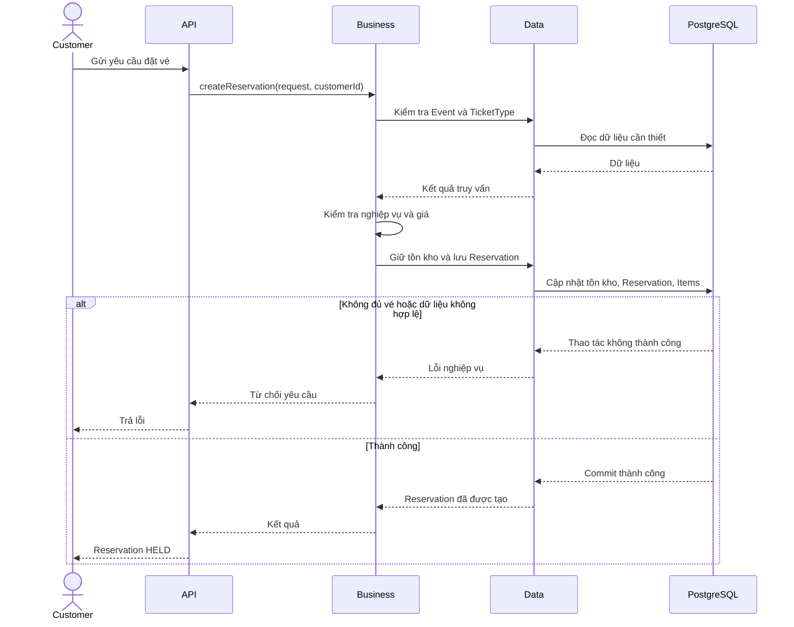

# Nghiệp vụ tạo Reservation

## 1. Mục tiêu

Cho phép Customer giữ một hoặc nhiều vé trong thời hạn 5 phút mà không làm vượt số lượng vé khả dụng.

Tạo reservation thành công đồng nghĩa với việc hệ thống đã giữ được số lượng vé tương ứng, không chỉ tạo một bản ghi reservation.

## 2. Tác nhân

Customer đã được xác thực.

## 3. Đầu vào nghiệp vụ

- `eventId`: Sự kiện cần đặt vé.
- Danh sách loại vé.
- Số lượng cần đặt cho từng loại vé.

Danh tính Customer được xác định từ ngữ cảnh xác thực, không lấy `userId` tùy ý từ client làm căn cứ phân quyền.

## 4. Quy tắc nghiệp vụ

1. Event phải tồn tại và ở trạng thái `PUBLISHED`.
2. Thời điểm hiện tại phải nằm trong khoảng `[starts_at, ends_at)`.
3. Mỗi số lượng yêu cầu phải lớn hơn 0.
4. Tất cả loại vé phải thuộc cùng Event.
5. Mỗi loại vé phải có đủ số lượng khả dụng.
6. Giá vé do hệ thống xác định.
7. Mỗi ReservationItem lưu giá tại thời điểm tạo.
8. Thời hạn giữ vé mặc định là 5 phút.
9. Việc tạo Reservation, tạo ReservationItem và giữ tồn kho phải nhất quán.

## 5. Luồng nghiệp vụ

1. Customer gửi yêu cầu đặt vé.
2. Hệ thống xác định Customer từ danh tính đã xác thực.
3. Kiểm tra Event có cho phép đặt vé.
4. Kiểm tra danh sách TicketType và số lượng yêu cầu.
5. Xác định giá từ dữ liệu phía máy chủ.
6. Kiểm tra và giữ số lượng vé trong cơ sở dữ liệu.
7. Tạo Reservation ở trạng thái `HELD`.
8. Tạo các ReservationItem với giá snapshot.
9. Thiết lập `expiresAt` bằng thời điểm tạo cộng 5 phút.
10. Trả kết quả gồm định danh reservation, trạng thái và thời điểm hết hạn.

Nếu bất kỳ thao tác bắt buộc nào thất bại, hệ thống không được để lại reservation thành công nhưng tồn kho chưa được giữ, hoặc tồn kho đã giữ nhưng không có reservation tương ứng.

## 6. Thiết kế kỹ thuật

Tồn kho phải được kiểm soát ở cơ sở dữ liệu để xử lý các yêu cầu đồng thời.

Ví dụ, nếu chỉ còn một vé nhưng hai Customer cùng đặt, tối đa một yêu cầu được giữ vé thành công.

Có thể cân nhắc khóa bản ghi hoặc cập nhật có điều kiện để bảo đảm điều kiện tồn kho vẫn đúng tại thời điểm cập nhật.

Tất cả thay đổi liên quan đến tồn kho và các bản ghi reservation cần được đặt trong một transaction phù hợp.

## 7. Sequence diagram

## 8. Ánh xạ package

- `api`: Nhận yêu cầu và kiểm tra định dạng dữ liệu.
- `business`: Kiểm tra Event, số lượng, giá và điều phối use case.
- `data`: Triển khai truy vấn, cập nhật tồn kho và lưu reservation.
- `infrastructure`: Cung cấp cấu hình transaction và các thành phần kỹ thuật hỗ trợ.
