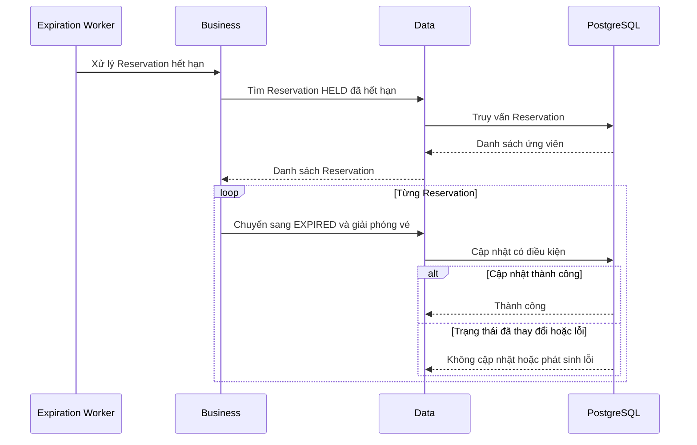

# Nghiệp vụ hết hạn Reservation

## 1. Mục tiêu

Giải phóng vé đang được giữ bởi Reservation không được xác nhận trong thời hạn quy định.

Thời hạn giữ vé mặc định của RushSeat là 5 phút.

## 2. Tác nhân

Đây là nghiệp vụ do hệ thống thực hiện. Có thể được kích hoạt bởi một tác vụ nền hoặc bởi một cơ chế kiểm tra thời hạn khi có yêu cầu liên quan.

## 3. Quy tắc nghiệp vụ

1. Chỉ Reservation ở `HELD` mới được chuyển sang `EXPIRED`.
2. Reservation phải đạt hoặc vượt thời điểm `expiresAt`.
3. Khi hết hạn, hệ thống giảm `held_quantity` tương ứng.
4. Reservation đã `CONFIRMED`, `CANCELLED` hoặc `EXPIRED` không được xử lý hết hạn lần nữa.
5. Không được vừa xác nhận vừa hết hạn thành công cho cùng một Reservation.
6. Nếu việc cập nhật trạng thái hoặc tồn kho thất bại, dữ liệu phải được giữ nhất quán.

## 4. Luồng nghiệp vụ

1. Hệ thống tìm các Reservation ở `HELD` đã hết hạn.
2. Kiểm tra lại trạng thái và thời điểm hết hạn.
3. Chuyển Reservation sang `EXPIRED`.
4. Giải phóng số lượng vé đang giữ.
5. Hoàn tất giao dịch.
6. Tiếp tục xử lý các Reservation hết hạn khác.

## 5. Thiết kế kỹ thuật

Có thể triển khai một tác vụ nền định kỳ để tìm và xử lý các Reservation hết hạn.

Tuy nhiên, tác vụ nền không phải cơ chế duy nhất bảo đảm đúng hạn. Hệ thống vẫn phải từ chối xác nhận một Reservation đã hết hạn, ngay cả khi tác vụ nền chưa chạy.

Khi có nhiều worker hoặc nhiều yêu cầu xử lý cùng Reservation, cần cơ chế cập nhật có điều kiện hoặc khóa phù hợp.

**Điểm chưa chốt:** Chu kỳ chạy tác vụ nền, kích thước mỗi lô và cách retry khi xử lý thất bại.

## 6. Sequence diagram

## 7. Ánh xạ package

- `api`: Không nhất thiết cần endpoint công khai cho tác vụ này.
- `business`: Định nghĩa điều kiện hết hạn và điều phối chuyển trạng thái.
- `data`: Tìm Reservation hết hạn và cập nhật tồn kho.
- `infrastructure`: Lập lịch, chạy worker và hỗ trợ retry nếu cần.
