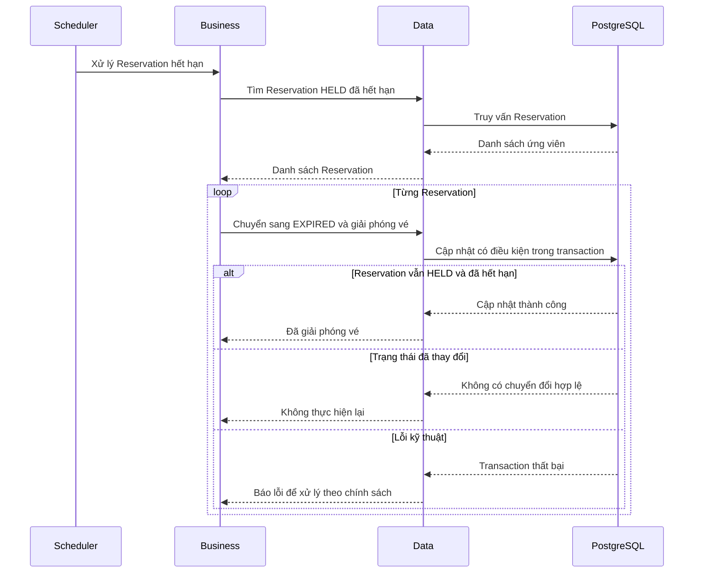

# Nghiệp vụ hết hạn Reservation

## 1. Mục tiêu

Giải phóng vé đang được giữ bởi Reservation không được xác nhận trong thời hạn quy định.

Thời gian giữ vé mặc định của RushSeat là 5 phút kể từ thời điểm tạo Reservation.

Hệ thống sử dụng hai cơ chế phối hợp:

- Tác vụ nền chạy định kỳ để tìm và xử lý Reservation đã hết hạn.
- Use case xác nhận tự kiểm tra thời hạn để từ chối Reservation hết hạn, kể cả khi tác vụ nền chưa chạy.

## 2. Tác nhân

Nghiệp vụ được thực hiện bởi:

- **Tác vụ nền:** Tìm và xử lý Reservation đã hết hạn.
- **Customer:** Có thể gửi yêu cầu xác nhận trước khi hết hạn.
- **Business layer:** Xác định điều kiện hết hạn và điều phối việc chuyển trạng thái.

## 3. Quy tắc nghiệp vụ

1. Chỉ Reservation ở trạng thái `HELD` mới được chuyển sang `EXPIRED`.
2. Reservation hết hạn khi thời điểm hiện tại lớn hơn hoặc bằng `expiresAt`.
3. Khi hết hạn được xử lý thành công, hệ thống giảm `held_quantity` tương ứng.
4. Reservation đã `CONFIRMED`, `CANCELLED` hoặc `EXPIRED` không được xử lý hết hạn lần nữa.
5. Tác vụ nền không được giải phóng vé nếu Reservation đã chuyển khỏi `HELD`.
6. Use case xác nhận không được chấp nhận Reservation đã hết hạn chỉ vì tác vụ nền chưa xử lý.
7. Việc cập nhật trạng thái và giải phóng tồn kho phải nhất quán.
8. Nếu nhiều yêu cầu cùng xử lý một Reservation, chỉ một thao tác được phép giải phóng vé.

## 4. Luồng xử lý bằng tác vụ nền

1. Tác vụ nền được kích hoạt theo lịch định kỳ.
2. Hệ thống tìm các Reservation ở `HELD` có `expiresAt` nhỏ hơn hoặc bằng thời điểm hiện tại.
3. Với mỗi Reservation, hệ thống kiểm tra lại điều kiện hết hạn trong quá trình cập nhật.
4. Chuyển Reservation sang `EXPIRED`.
5. Giảm `held_quantity` theo số lượng trong các ReservationItem.
6. Commit thay đổi.
7. Tiếp tục xử lý các Reservation còn lại.
8. Ghi nhận lỗi và xử lý tiếp theo chính sách retry nếu một Reservation không thể xử lý.

Không được giả định rằng mọi Reservation được tìm thấy ở bước đầu vẫn còn hợp lệ tại thời điểm cập nhật. Trạng thái có thể thay đổi do một yêu cầu xác nhận hoặc hủy đồng thời.

## 5. Luồng xác nhận khi Reservation hết hạn

1. Customer gửi yêu cầu xác nhận Reservation.
2. Hệ thống kiểm tra quyền sở hữu.
3. Hệ thống kiểm tra trạng thái Reservation.
4. Hệ thống kiểm tra `expiresAt`.
5. Nếu thời điểm hiện tại lớn hơn hoặc bằng `expiresAt`, hệ thống không xác nhận Reservation.
6. Reservation được xử lý hết hạn và giải phóng vé theo cơ chế an toàn.
7. Nếu Reservation vẫn còn hiệu lực, hệ thống tiếp tục kiểm tra trạng thái Event và các điều kiện xác nhận khác.

Việc từ chối xác nhận một Reservation đã hết hạn không được phụ thuộc vào thời điểm tác vụ nền chạy.

## 6. Thiết kế kỹ thuật

### 6.1. Lập lịch

Tác vụ nền có thể được triển khai bằng cơ chế scheduling của Spring.

Chu kỳ chạy và số lượng Reservation xử lý trong mỗi lô sẽ được xác định khi triển khai và đánh giá tải.

Không cần Redis hoặc Kafka để triển khai cơ chế hết hạn cơ bản trong MVP.

### 6.2. Kiểm soát đồng thời

Tình huống cần xử lý là tác vụ nền và yêu cầu xác nhận cùng tác động đến một Reservation.

Hệ thống phải bảo đảm:

- Chỉ một chuyển đổi trạng thái hợp lệ được commit.
- Reservation đã hết hạn không được xác nhận thành công.
- `held_quantity` không bị giảm hai lần.
- Transaction thất bại không để lại trạng thái Reservation và tồn kho mâu thuẫn.

Có thể sử dụng khóa bản ghi hoặc cập nhật có điều kiện, kết hợp transaction phù hợp với PostgreSQL.

### 6.3. Xử lý theo lô

Nếu số lượng Reservation hết hạn lớn, hệ thống có thể xử lý theo từng lô để giới hạn số bản ghi và thời gian khóa.

Khi sử dụng nhiều worker, cần bảo đảm các worker không cùng giải phóng một Reservation nhiều lần.

### 6.4. Retry

Chỉ retry các thao tác có cơ chế bảo đảm tính lặp an toàn.

Nếu một lần xử lý thất bại, hệ thống cần xác định liệu transaction đã commit hay chưa trước khi quyết định xử lý lại. Không được giả định rằng mọi lỗi kết nối đều đồng nghĩa với transaction chưa thành công.

## 7. Sequence diagram

## 7. Các trường hợp lỗi cần kiểm thử
- Reservation hết hạn và được tác vụ nền xử lý.
- Reservation chưa hết hạn không bị xử lý.
- Reservation đã CONFIRMED không bị chuyển sang EXPIRED.
- Reservation đã CANCELLED không bị giải phóng vé lần nữa.
- Tác vụ nền chạy đồng thời với yêu cầu xác nhận.
- Hai worker cùng tìm thấy một Reservation hết hạn.
- Transaction thất bại khi cập nhật tồn kho.
- Tác vụ nền chạy chậm nhưng Customer vẫn không thể xác nhận Reservation đã hết hạn.
- Tác vụ nền xử lý một lô có một Reservation lỗi nhưng vẫn có thể tiếp tục xử lý các bản ghi khác theo chính sách đã chọn. 

## 8. Ánh xạ package

- `api`: Nhận yêu cầu xác nhận Reservation; không nhất thiết cần endpoint công khai để chạy tác vụ nền.
- `business`: Định nghĩa điều kiện hết hạn và điều phối chuyển trạng thái.
- `data`: Tìm Reservation hết hạn và cập nhật trạng thái và tồn kho.
- `infrastructure`: Lập lịch, chạy worker và hỗ trợ retry nếu cần.
