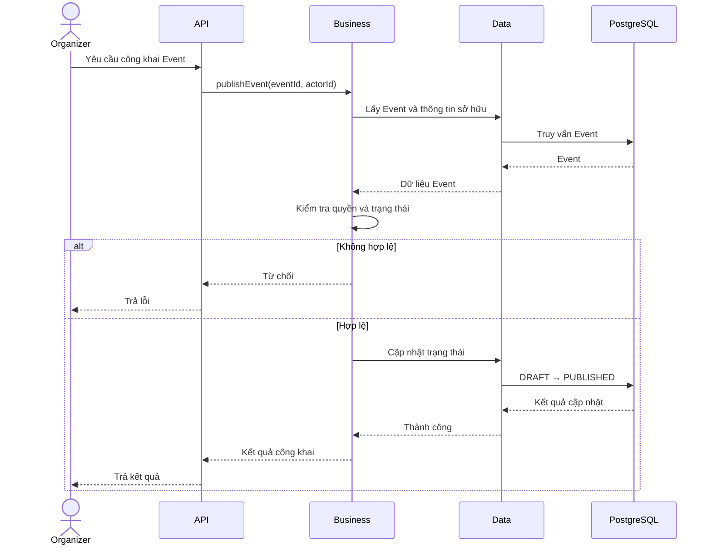

# Nghiệp vụ công khai sự kiện

## 1. Mục tiêu

Cho phép Organizer công khai một Event đã được chuẩn bị, chuyển Event từ `DRAFT` sang `PUBLISHED`.

Sau khi công khai, Event có thể nhận reservation khi thỏa mãn điều kiện về thời gian mở bán.

## 2. Tác nhân

- Organizer sở hữu Event.
- Admin có quyền quản lý Event trên toàn hệ thống.

Customer không có quyền công khai Event.

## 3. Quy tắc nghiệp vụ

1. Event phải tồn tại.
2. Organizer chỉ được công khai Event thuộc quyền sở hữu của mình.
3. Admin được thực hiện thao tác theo quyền quản trị.
4. Event phải ở trạng thái `DRAFT`.
5. Thông tin bắt buộc và khoảng thời gian của Event phải hợp lệ.
6. Công khai Event không có nghĩa là có thể đặt vé ngay lập tức.
7. Event chỉ nhận reservation khi trạng thái là `PUBLISHED` và thời điểm hiện tại thuộc khoảng `[starts_at, ends_at)`.

## 4. Luồng nghiệp vụ

1. Organizer chọn Event cần công khai.
2. Hệ thống kiểm tra quyền và quyền sở hữu.
3. Hệ thống kiểm tra trạng thái và thông tin Event.
4. Nếu hợp lệ, Event chuyển từ `DRAFT` sang `PUBLISHED`.
5. Hệ thống trả kết quả cho Organizer.

Nếu Event không tồn tại, người dùng không đủ quyền hoặc Event không hợp lệ, thao tác bị từ chối và trạng thái không thay đổi.

## 5. Thiết kế kỹ thuật

Đầu vào chính là `eventId` và danh tính người thực hiện được xác định từ ngữ cảnh xác thực.

Không nhận `createdById` từ client làm căn cứ duy nhất để xác định quyền sở hữu.

Việc kiểm tra quyền và cập nhật trạng thái phải bảo đảm Event không bị chuyển từ một trạng thái không hợp lệ sang `PUBLISHED` do hai yêu cầu đồng thời.

## 6. Sequence diagram

## 7. Ánh xạ package

- `api`: Endpoint công khai Event.
- `business`: Use case công khai Event, kiểm tra quyền và điều kiện chuyển trạng thái.
- `data`: Adapter đọc và cập nhật Event.
- `infrastructure`: Cung cấp cơ chế transaction và cấu hình liên quan nếu cần.
